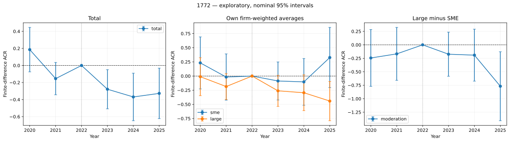

# Labor Productivity · Continuous DiD

**설정 하나를 바꾸고 실행하면 결과표·그래프·HTML 보고서가 나오는 독립 프로젝트입니다.**
기본값은 `1772`입니다. 연속형 데이터도 포함되어 있어 별도 파일 이동이 필요 없습니다.



## 1. 설치와 실행

Python **3.12**를 사용합니다. 저장소의 이 브랜치를 내려받은 뒤 프로젝트 폴더에서 실행하세요.

```bash
git clone --single-branch --branch feature/compact-dml-runner https://github.com/wnghks3758-star/AI_diffusion_to_Labor_Productivity.git
cd AI_diffusion_to_Labor_Productivity
python3.12 -m venv .venv
source .venv/bin/activate
python -m pip install -r requirements.txt

# 빠른 동작 확인: 표본은 그대로, 학습 예산과 격자 등을 줄인 미리보기
python run.py --quick

# 1772에서 이미 선택된 파라미터로 전체 추정: 재튜닝 시간을 절약
python run.py --config examples/fixed_1772.json

# 1772의 원래 150개 후보 튜닝부터 다시 수행
python run.py
```

Windows에서는 가상환경 활성화에 `.venv\Scripts\activate`를 사용합니다.
첫 전체 실행은 연도마다 150개 후보를 튜닝하고 200개 Mu 모형을 학습하므로 시간이 걸립니다.
`--quick`은 축소 설정으로 계산한 별도 결과이며, 1772 재현값과 구분됩니다.
진행 단계와 연도별 완료를 터미널에 출력합니다.
`examples/fixed_1772.json`은 연도별 선택값을 고정하고 원래 Fold·반복·격자로 재학습합니다.
전체 표본을 줄이지 않으며 1772 결과를 재현합니다.

## 2. 설정 변경

**방법 A — `settings.json` 수정:** 변수 목록, 모형, Fold, ESS, bandwidth 등을 한 파일에서 바꿉니다.
GPS와 Mu 변수는 `gps_features`, `mu_features`에서 각각 추가·삭제합니다.
처치변수와 산업 더미는 코드가 자동으로 붙이므로 이 목록에 넣지 않습니다.

**방법 B — 명령어에서 덮어쓰기:** 파일을 수정하지 않고 실행합니다. 값은 JSON 문법입니다.

```bash
python run.py --set bandwidth_scale=0.4 --set ess=3
python run.py --set 'bandwidth_statistic="std"'
python run.py --set n_splits=5 --set n_repeats=20 --set inner_splits=5
python run.py --set industry_min_groups=6 --set industry_min_obs=6
python run.py --drop-gps ln_cum_patent --drop-mu firm_rnd_ratio ln_firm_ast

# 튜닝 없이 지정한 XGBoost 설정 사용
python run.py --set mu_search_n_iter=0 \
  --set 'mu_params={"max_depth":3,"n_estimators":300,"learning_rate":0.03}'
```

`--set`은 `--quick` 뒤에 적용됩니다. `--drop-gps`와 `--drop-mu`는 해당 변수 목록에서만 제외합니다.
한쪽 모형에서 뺀 변수는 다른 쪽에 남아 있을 수 있습니다.
JSON 파일은 일부 항목만 적어도 나머지는 1772 기본값을 사용합니다.
`mu_params_by_year`에 지정된 연도는 해당 파라미터를 사용하고 튜닝을 생략합니다.
변수를 바꾼 뒤 파라미터도 다시 선택하려면 기본 `settings.json`을 사용하거나
`--set 'mu_params_by_year={}'`로 고정값을 해제하세요.
Python에서도 설정·분석 함수를 바로 쓸 수 있습니다.

```python
from labor_did import run

results = run({"bandwidth_statistic": "std", "bandwidth_scale": 0.4})
print(results.query("effect in ['total', 'sme', 'large', 'moderation']"))
```

## 3. 여러 설정 비교

`--grid`는 지정한 후보들의 모든 조합을 순서대로 실행합니다.
아래 명령은 2 × 2 × 2 = **8개 설정**입니다.

```bash
python run.py \
  --grid 'gps_n_knots=[4,5]' \
  --grid 'bandwidth_statistic=["sigma","std"]' \
  --grid 'bandwidth_scale=[0.4,0.45]' \
  --out results/comparison_8
```

변수 묶음도 비교할 수 있습니다. 예를 들어 아래는 작은 GPS 변수 목록 두 개를 비교합니다.
이 예제는 1772의 변수 목록을 대체합니다.

```bash
python run.py --quick \
  --grid 'gps_features=[["ln_ind_avg_pay","ln_ind_ast"],["ln_ind_avg_pay","ln_ind_ast","ind_avg_hours_pre"]]' \
  --out results/variables
```

각 설정은 독립 폴더에 저장됩니다. `comparison.csv`에는 현재 일괄 실행의 모든 완료 결과,
`attempts.json`에는 실패를 포함한 모든 시도와 전체 설정을 남깁니다.
같은 `--out`을 다시 사용하면 두 파일은 **이번 명령의 비교표·실행 기록**으로 갱신되고,
기존 개별 결과 폴더는 유지됩니다. 서로 다른 비교 실험에는 다른 `--out`을 사용하세요.

## 4. 결과 보기

실행이 끝나면 결과표와 저장 위치가 터미널에 출력됩니다.
해당 폴더의 **`report.html`을 브라우저로 열면 그래프·결과표·전체 설정을 함께 볼 수 있습니다.**

```text
results/<이름>_<설정해시>/
  report.html          브라우저에서 보는 보고서
  event_study.png      전체 / SME·Large / Large−SME 그래프
  summary.csv          주요 네 효과의 결과표
  estimates.csv        공통표본 효과 등을 포함한 전체 결과
  endpoints.csv        평균 계산에 사용한 처치점별 진단
  config.json          실제 실행 설정
  sample.json          표본 수·더미 목록·표본 해시
  audit.json           GPS alpha·Mu 선택값·캐시·지지구간 진단
  status.json          완료 여부·데이터/코드 해시·패키지 버전
  years/<연도>/         중단 후 재개를 위한 연도별 결과
```

주요 열은 `estimate`, `se`, `p_value`, `ci_lower`, `ci_upper`, `coverage`입니다.
`coverage`는 해당 평균 계산에 실제 사용된 기업 비율입니다.
`estimate`는 유한 차분으로 계산한 **ACR**이며, 처치 간격의 ATET는
`atet_estimate = estimate × diff_step`으로 `estimates.csv`에 함께 저장합니다.
`moderation`은 **Large − SME**입니다. `size_difference="means"`가 기본이며,
`"common"`으로 바꾸면 공통 평균 가중치를 사용합니다.

`p_value`와 그래프 구간은 명목 추론입니다. `p_holm_within_spec`은 한 설정 내
연도 × 네 효과, `p_holm_batch`는 현재 일괄 실행에서 계획한 전체 검정 수를 기준으로 보정합니다.
여러 실행 명령 전체를 합친 보정은 아닙니다. 모든 설정을 저장하며 유의성에 따라 결과를 숨기지 않습니다.
추론은 학습한 모형·선택한 지지구간·최종 가중치에 조건부입니다.

## 5. 1772 기본값

| 구분 | 값 |
|---|---|
| 기준연도 / 분석연도 | 2022 / 2020·2021·2023·2024·2025 |
| 종속변수 / 처치 | `ln_firm_prod` / `ln(office_ratio × 100)` |
| GPS 변수 | 산업 공변량 12개 + 산업 더미 20개 |
| Mu 변수 | 공변량 18개 + 산업 더미 20개 + 처치 |
| GPS | Spline 5 knots, 3차, 분위수 knot + 표준화 + Ridge |
| Mu | XGBoost `exact`, 연도별 150개 후보 탐색 |
| Fold / 반복 / 튜닝 Fold | 4 / 50 / 4 |
| 산업 분류 기준 | 최소 산업 수 4, 최소 관측수 4 |
| 공통하한 ESS / 연도별 ESS | **0 / 5** |
| Bandwidth | `sigma=min(std,IQR/1.34)`, 배율 0.45 |
| 트리밍 / 밀도 하한 | 0.1 / 0.005 |
| 미분 간격 | 0.0005 |
| Bootstrap | 산업 단위, 5,000회, seed 42 |
| 규모 차이 / 지지구간 공백 | `means` / `bridge` |

**GPS에서만 `ind_avg_hours_pre`를 제외하며 Mu에는 포함합니다.**
사전 차분은 원래 노트북대로 `Y_2022 − Y_사전연도`입니다.
`pre_sign="chronological"`이면 부호를 반대로 바꿉니다.
전체 기본값과 탐색 후보는 `settings.json`에서 확인하세요.

산업 내 2022년까지 평균 매출의 중앙값 이상을 Large로 분류합니다.
재현성을 위해 매출 결측치 비교를 포함한 원래 규모 분류 규칙과 행 순서를 유지합니다.
XGBoost는 기업 공변량 결측치를 허용합니다. 식별자·처치·결과변수·GPS 입력 오류는 명시적으로 실패합니다.
산업별 고정 처치와 산업 이동이 없는 균형 패널을 전제로 합니다.

공통하한을 찾는 전처리는 원본처럼 **robust sigma·배율 0.5**를 사용합니다.
`bandwidth_statistic`과 `bandwidth_scale`은 이후 연도별 추정의 bandwidth를 바꿉니다.
공통하한 ESS가 0일 때는 관측 처치 최솟값을 하한으로 유지합니다.

GPS는 산업군 층화 Fold, Mu는 산업 전체를 함께 분리하는 그룹 Fold를 사용합니다.
산업군에 산업이 적으면 실제 Fold 수가 요청값보다 줄어들 수 있으며 실제 분할은 진단 파일에 기록됩니다.
GPS alpha는 첫 반복의 전체 산업 CV에서 선택하고, Mu도 기본적으로 전체 표본 CV에서
한 번 튜닝한 값을 교차적합에 사용합니다. Mu는 `tuning_scope="nested"`도 지원합니다.

## 6. 코드와 성능

| 파일 | 역할 |
|---|---|
| `run.py` | 단일 실행·설정 덮어쓰기·조합 비교 |
| `labor_did/config.py` | 기본값·설정 검증 |
| `labor_did/data.py`, `industry.py` | 데이터 읽기·표본·규모·산업 더미 |
| `labor_did/models.py` | GPS·Mu 학습과 교차적합 예측 |
| `labor_did/weights.py`, `support.py` | 커널·트리밍·ESS·평균 가중치 |
| `labor_did/score.py`, `estimation.py` | 처치점별 ACR과 연도별 추정 |
| `labor_did/aggregation.py` | 산업별 영향함수 합산·공동 Bootstrap |
| `labor_did/plot.py`, `pipeline.py` | 시각화·체크포인트·결과 저장 |
| `labor_did/io.py` | 원자적 JSON 저장·데이터/설정/코드 캐시 키 |

- Excel은 최초 한 번 읽고 파일 해시별로 캐시합니다.
- GPS·Mu는 실제 입력과 해당 모형 설정이 같으면 재학습하지 않습니다.
  예를 들어 ESS·트리밍·bandwidth만 바꾸면 같은 Mu를 재사용합니다.
- XGBoost가 같은 값을 예측하는 처치 구간은 트리 분기점을 이용해 한 번만 계산합니다.
- 필요한 평균 끝점만 예측하고, 반복별 예측은 디스크 `memmap`으로 처리합니다.
  중앙값 예측도 캐시하므로 같은 끝점에 대한 계산을 반복하지 않습니다.
- Bootstrap은 산업별 영향함수를 먼저 합산한 뒤 수행합니다.
  격자 전체 × Bootstrap의 대형 배열을 만들지 않습니다.
- 연도·설정은 순차 처리하고 모형 학습 작업만 제한적으로 병렬화합니다.
  같은 캐시 폴더를 사용하는 명령을 동시에 실행하지 마세요.
- 완전히 같은 실행은 저장 결과를 즉시 불러옵니다.
  중단 시 같은 명령을 실행하면 완료된 연도부터 재개합니다.
  코드·데이터·설정이 달라진 명시적 출력 폴더는 덮어쓰지 않습니다.
- `.cache/`와 `results/`는 Git에 포함하지 않습니다.
  캐시를 지우면 다시 학습하므로 용량이 필요할 때 삭제하세요.

## 7. 검증

```bash
python -m unittest discover -s tests -v
```

가중치 미분, 공동 Bootstrap 공분산, 산업별 ESS 압축, Fold 누출 방지,
트리 예측과 반복 중앙값의 일치, 캐시, 실제 학습, 중단 후 재개, 실패 기록을 검증합니다.
기존 1772와의 재현 비교 범위와 오차는 `examples/verification_1772.json`,
주요 결과는 `examples/1772_results.csv`에 있습니다.
전체 표본에서 GPS와 연도별 Mu 모형 1,000개를 새로 학습해 5개 연도·40개 결과 행을
비교했으며, 추정값·표준오차·p값·신뢰구간·bandwidth·coverage의 최대 차이는 0이었습니다.
별도로 2020년의 원래 150개 후보 튜닝도 다시 실행해 같은 선택값을 확인했습니다.
