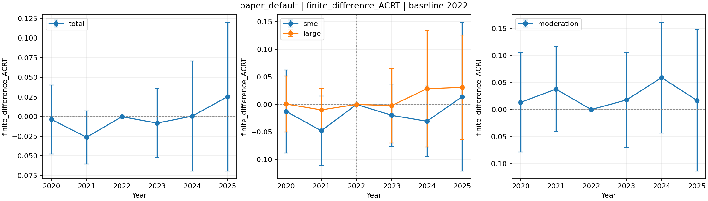

# 기업 생산성 · 산업 단위 연속처치 DiD

**새 실행 명령은 `python run_paper.py`입니다.** 저자 ATET의 수치 계산에 맞추고,
기업별 결과와 산업 단위 처치 구조를 유지했습니다. 이 브랜치는
`feature/paper-aligned-did`이며 기존 실행기는 [1772 문서](README_1772.md)에 있습니다.

## 설치와 기본 실행

```bash
git clone --single-branch --branch feature/paper-aligned-did https://github.com/wnghks3758-star/AI_diffusion_to_Labor_Productivity.git
cd AI_diffusion_to_Labor_Productivity
python3.12 -m venv .venv
source .venv/bin/activate
python -m pip install -r requirements.txt
python run_paper.py --out results/my_trial
```

Windows의 가상환경 활성화 명령은 `.venv\Scripts\activate`입니다.
연속처치 데이터가 포함되어 있어 경로를 옮길 필요가 없습니다.

설정은 [paper_settings.json](paper_settings.json) 한 파일에서 변경합니다.
기본값은 GPS Spline·Mu XGBoost, 산업 GPS·기업 결과, 2022년 통제변수,
산업 3-Fold, SD bandwidth × 0.7, R np 커널·양쪽 트리밍입니다.
ESS는 진단만 남기고 밀도 하한은 적용하지 않습니다.

## 자주 바꾸는 설정

```bash
# GPS를 Random Forest로 변경: 밀도는 계속 조건부 정규밀도(psmethod=1)
python run_paper.py --set 'gps_model="random_forest"' --out results/gps_rf

# Mu를 Lasso로 변경
python run_paper.py --set 'mu_model="lasso"' --out results/mu_lasso

# Mu에서 기업 변수와 기업 규모 더미를 모두 제외: 규모별 분석 자체는 유지
python run_paper.py --set include_firm_controls=false --out results/no_firm

# 계산 불가 구간을 보간하는 기본값 대신, 그 구간의 기업을 제외
python run_paper.py --set 'gap_policy="exclude"' --out results/exclude

# ATET만 빠르게 시험
python run_paper.py --set compute_acrt=false --out results/atet_only

# 직접 지정한 처치값 비교: 값은 현재 변환된 D 척도
python run_paper.py --set 'pair_scale="value"' \
  --set 'atet_pairs=[[2.8,3.5]]' --out results/atet_pair

# 명시한 학습기 조합을 비교하고 모든 결과·실패 기록
python run_paper.py --grid 'gps_model=["spline","random_forest","lasso"]' \
  --set compute_acrt=false --out results/gps_comparison
```

두 모형 모두 `spline`, `random_forest`, `lasso`, `ridge`, `linear`, `xgboost`를 지원합니다.
모형별 파라미터는 `gps_params`, `mu_params`로 전달합니다. 예시:

```bash
python run_paper.py \
  --set 'gps_model="random_forest"' \
  --set 'gps_params={"n_estimators":300,"max_depth":3,"min_samples_leaf":8}' \
  --set 'mu_params={"n_estimators":500,"max_depth":3,"learning_rate":0.02}' \
  --out results/custom
```

## 결과와 재현

- `summary.csv`: 전체·SME·Large·조절효과의 ATET와 ACRT.
- `estimates.csv`: 공통 노출분포를 사용한 집계까지 포함한 전체 결과.
- `report.html`, `*.png`: 표·그림·실행 설정.
- `years/연도/`: 계산 가능 구간, 처치점별 결과, Fold·모형 진단, 군집 점수.
- `config.json`, `sample.json`, `status.json`: 전체 설정·표본·구현/자료 해시.

동일한 코드·설정·데이터로 다시 실행하면 완료 결과나 연도별 체크포인트를 재사용합니다.
다른 설정을 같은 출력 폴더에 쓰려 하면 중단하므로 새 `--out`을 지정하세요.

[단계별 코드와 설정 설명](paper_did/README.ko.md) ·
[실제 시험 보고서](audit/Paper_Aligned_Trial_ko.md) ·
[저자 ATET 구현 비교](audit/ATET_comparison_ko.md)



기본 시험은 기업 2,028개·산업 151개로 수행했습니다. ACRT 평균의 포함 범위는
계산 가능한 처치 구간의 기업 2,024개(99.80%)입니다. 미포함 기업과 실패도 기록했습니다.
저자 패키지의 전체 재현은 아닙니다. Spline·XGBoost 선택, GPS/Mu 공변량 차이,
산업 단위 학습·분할·표준오차, ACRT 변환·보간·합산은 구분해 설명합니다.

```bash
python -m unittest discover -s tests -v
```

## 개별 변수·설정 200개 탐색

```bash
# 실행 전 설정을 확정한 뒤, 중단 기준을 통과한 결과만 저장
python search_paper.py plan
OPENBLAS_NUM_THREADS=1 OMP_NUM_THREADS=1 python search_paper.py run --workers 3

# 중간 결과 ZIP / 완료 후 보고서(PDF·DOCX는 pandoc 및 XeLaTeX 필요)
python report_paper_search.py checkpoint
python report_paper_search.py report
```

GPS와 Mu의 산업 변수, Mu의 기업 변수를 **각각 하나씩 제외**하거나 개별 조합으로
포함·제외합니다. 40개 변수·학습기 조합과 5개 bandwidth·트리밍 조합을 비교합니다.
정확한 200개 설정은 실행 전에 생성되는 `audit/results/paper_search_200/plan.json`에
고정하며, 이미 있는 계획을 덮어쓰지 않습니다. 다른 계획은 `--out`으로 분리하세요.

2020·2021년 전체/SME/Large/조절효과가 모두 p≥0.05이고 2023년 전체가 유의한
음수인 경우에만 2024·2025년까지 계산해 보존합니다. 한 기준이라도 실패하면
즉시 해당 실행을 중단하고 임시 추정치·로그·캐시를 삭제합니다. 탈락별 추정값은
저장하지 않고 중단 유형별 건수만 남깁니다. 재실행하면 완료된 5개 묶음은 건너뜁니다.
현재 실행기는 2023년 초기 하락을 먼저 검사해 불필요한 사전 연도 계산을 줄입니다.
이번 실제 배치에서 검사 순서만 바꾼 이력은 계획 파일에 기록했습니다.

[이번 200개 탐색 보고서](audit/Paper_Search_200_ko.md): 저장 기준 통과 5개,
전체 가설 충족 0개입니다. GitHub에는 통과 사례의 설정·결과·보고서 그래프를 담고,
연도별 세부 진단까지 포함한 전체 결과 ZIP과 PDF·DOCX는
[Google Drive 결과 폴더](https://drive.google.com/drive/folders/1V1cV3H4h0vxi9_C7aVwiV2a6EE8QEudB)에 저장합니다.

이는 결과를 기준으로 설정을 선택하는 **탐색**입니다. 점별 원래 p값과 이번 배치의
계획된 4,000개 ACRT 검정에 대한 Bonferroni 보정값을 별도로 제공합니다.
사전 비유의가 평행추세를 증명하지 않으며, 이전 탐색까지 보정한 결과도 아닙니다.

## 추가 200개: 201~400번

```bash
python search_paper_more.py plan
OPENBLAS_NUM_THREADS=1 OMP_NUM_THREADS=1 python search_paper_more.py run --workers 3
python report_paper_search.py checkpoint --out audit/results/paper_search_201_400
python report_paper_search.py report --out audit/results/paper_search_201_400
```

이전 200개와 중복되지 않는 설정을 고정 seed로 생성합니다. 이전 183·191번 주변의
개별 변수 추가·제외 20개 조합과 새로운 변수·학습기 조합 20개에 각각 5개
bandwidth·트리밍 조합을 적용합니다. 판정과 중단 규칙은 이전 배치와 같습니다.
기업 변수 전체 제외 시 비활성 변수 목록을 정규화해 실질적인 중복도 검사합니다.

원래 p값, 이번 배치 4,000개 검정 보정, 두 배치 누적 8,000개 검정 보정을
별도로 제공합니다. 이전 결과를 보고 후보를 정한 후속 탐색이며, 누적 보정도
이 두 배치 이전의 탐색을 포함하지 않습니다. 결과와 보고서는
[Google Drive](https://drive.google.com/drive/folders/1pO4_k0HPp9X4uDpw5f3yGeM3Pya1VL6Q)에 저장합니다.
추가 배치의 분석 산출물은 Git에 포함하지 않습니다.

## 이어서 401~600번

먼저 Drive의 201~400번 결과 ZIP을 `audit/results/paper_search_201_400/`에
풀어 두세요. 이 배치의 계획과 기준 설정 파일을 이용해 앞선 400개와 중복을 검사합니다.

```bash
python search_paper_next.py plan
OPENBLAS_NUM_THREADS=1 OMP_NUM_THREADS=1 python search_paper_next.py run --workers 3
python report_paper_search.py checkpoint --out audit/results/paper_search_401_600
python report_paper_search.py report --out audit/results/paper_search_401_600
```

후속 설정 200개를 실행 전에 고정하고 같은 중단 기준을 적용합니다. 이번 배치
4,000개 검정 보정과 세 배치 누적 12,000개 검정 보정을 분리하며,
결과·보고서는 [해당 Drive 폴더](https://drive.google.com/drive/folders/1qXWiQe-pU79NqTiaHmg88XvIn5S4A4Fv)에 저장합니다.

## 601~800번과 조건 충족 결과 통합

앞선 세 배치의 결과 ZIP을 각각 원래 경로에 풀고 실행합니다. 이전 600개와
중복되지 않는 200개를 고정하고, 같은 저장 기준과 즉시 중단 규칙을 적용합니다.
이 배치 보정은 4,000개, 논문 방식 네 배치 누적 보정은 16,000개 검정입니다.

```bash
python search_paper_fourth.py plan
OPENBLAS_NUM_THREADS=1 OMP_NUM_THREADS=1 python search_paper_fourth.py run --workers 3
python report_paper_search.py checkpoint --out audit/results/paper_search_601_800
python report_paper_search.py report --out audit/results/paper_search_601_800
python report_focused_history.py --batch audit/results/paper_search_601_800
```

축약 통합 보고서는 기본 저장 기준에 더해 **SME 2025 양수**와
**2025년 Large−SME 음수·p<0.05**인 설정만 수록합니다. SME의 양수 유의성은
따로 표시합니다. 이전 방식과 논문 방식은 구분하고 보관본 중복은 제거합니다.
`report_focused_history.collect(roots={"legacy": Path(...), "paper": Path(...)})`로
다른 작업공간의 보관 위치를 지정할 수 있습니다. 결과는
[Labor_Productivity의 전용 폴더](https://drive.google.com/drive/folders/1X_NQZhN5uPzMo3_GeHmlmAeB_2YJ6ai4)에
저장하며 원자료와 학습 모델은 업로드하지 않습니다. Git에는 코드만 포함합니다.
