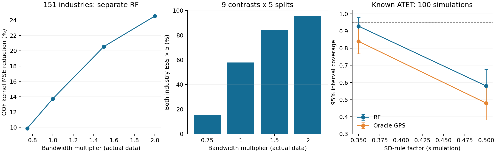

# 1. 판단

**151개 산업에서도 직접 커널 GPS는 학습되며 일부 처치 구간에서는 사용할 여지가 있다. 그러나 현재 자료 전체에서 안정적인 ATET 추론이 검증되었다고 할 수는 없다.** 저자 R 함수처럼 각 처치점에 대해 RF를 따로 학습했을 때, 기준 bandwidth의 커널값 예측오차는 공변량 없는 기준보다 **13.7% 작았다**. 반면 점검한 처치쌍·반복 45건 중 양쪽 산업 ESS > 5는 **26건(57.8%)**뿐이었다. 최대 한 산업의 정규화 가중치는 **67.4%**였다.

**직접 커널 회귀 자체는 논문에 명시된 방법이다.** 다만 논문의 정당화는 식별·overlap·학습 오차율·bandwidth 조건을 전제로 하는 점근 이론이다. 산업 151개와 특정 RF 설정에서 이 조건들이 충족된다는 보장은 별도 문제이다.

실제 자료의 결과변수는 이번 검증의 모형 비교·채택에 사용하지 않았다. 효과의 부호나 p값에 따른 탐색은 하지 않았고, 실패와 낮은 ESS도 모두 기록했다. ATET의 알려진 정답과 신뢰구간 성능은 별도의 모의자료에서만 확인했다.



# 2. 논문에서 무엇을 정당화하는가

첨부 파일은 최초 공개 연도 2024년인 논문의 **arXiv:2410.21105v2, 2026-01-15** 버전이다. 6절, 인쇄 쪽수 24쪽은 패널 GPS의 bandwidth 의존 표적을 다음과 같이 정의한다. 여기서는 처치 이력 등 조건부 변수 전체를 $X$로 줄여 쓴다.

$$q_h(d,X)=E[\omega(D;d,h)\mid X],\qquad
\omega(D;d,h)=h^{-1}K((D-d)/h).$$

즉 $D$의 평균과 분산을 회귀한 뒤 정규밀도를 계산하는 대신, **각 관측치의 커널 높이를 종속변수로 만들어 $X$에 회귀**한다. 유한한 $h$에서 표적은 평활화된 밀도 $q_h$이며, 정확한 점밀도 $f(d\mid X)$와 같지는 않다. 조건부 정규분포를 가정할 필요가 없다.

- **Assumptions 14–15, 25쪽:** 패널의 분모 GPS 양성·유계성·매끄러움과 nuisance의 $L_2$ 학습 오차율 등을 요구한다.
- **Assumption 15(a):** $h\to0$, $Nh\to\infty$, $\sqrt{Nh^5}=o(1)$이다. bandwidth를 늘려 ESS만 높이면 된다는 결론은 나오지 않는다.
- **Lemma 1, 25쪽:** 커널 근사 편향은 $O(h^2)$이다.
- **Theorems 1–2, 26쪽:** 식별 가정과 위 정칙 조건, nuisance 수렴률 아래 점근 정규성과 분산 추정의 일관성을 제시한다. 특정 RF를 쓰기만 하면 자동 적용되는 정리는 아니다.

따라서 “`psmethod=2`는 논문에 근거가 있는가?”에는 **그렇다**고 답할 수 있다. “151개이면 안정적인 p값이 보장되는가?”에는 **그렇지 않다**. 논문 시뮬레이션의 표본 2,000·4,000도 이번 산업 151개에 대한 직접적인 보증은 아니다.

## R 구현과 이번 검증의 관계

`causalweight 1.1.6`의 `didcontDMLpanel.R`은 60–63행에서 커널 가중치를 회귀 표적으로 만들고, 90–94행에서 처치점과 비교점에 대한 두 회귀를 별도로 적합한다. `MLmethod="randomforest"`도 공식 선택지이다.

이번에는 같은 표적·두 팔 정규화·양쪽 트리밍을 Python에서 구현했다. **전체 R 패키지와 SuperLearner의 학습을 실행한 검증은 아니다.** RF 엔진과 세부 설정도 같다고 주장하지 않는다. 기존 보고서의 공식 R 점수 블록 수치 검증과 이번 자동 테스트는 주어진 nuisance에서의 ATET 대수 일치를 확인한다.

R은 전체 커널합으로 표적을 미리 나누지만, 이 처치점별 상수는 최종 정규화 비율에서 상쇄된다. 별도 RF는 표적의 상수 배율에 대해 동등하므로 이번 원래 커널 높이 회귀와 대응한다. 여러 처치점을 한 RF로 함께 학습한 빠른 보조 모형은 분할 기준이 달라질 수 있어 별도로 표시했다.

# 3. 실제 151개 산업 검증 설계

| 항목 | 내용 |
|---|---|
| 자료 | 기존 연속처치 데이터, 기존 전처리·공통 하한 ESS 0 유지 |
| 표본 | 기업 2,028개, 산업 151개; GPS 학습은 산업당 한 행 |
| 공변량 | 기존 GPS 산업 변수 12개 + 산업 더미 20개 = 32개 |
| 분할 | 산업 전체를 분리한 층화 4-Fold × 5회, seed 42부터 |
| RF | 200 trees, depth 3, min leaf 8, max features 0.75, 처치점별 별도 학습 |
| 보조 모형 | depth 2/leaf 10 및 depth 3/leaf 8의 다중 출력 RF, 학습 Fold의 무조건 평균 |
| 평가 처치점 | 산업 처치 분포의 5·10·25·50·75·90·95 분위수 |
| 처치쌍 | 인접 분위수 6개 + 25→75, 10→90, 5→95의 3개 = 9개 |
| 진단 | 검증 Fold 커널값 MSE, 산업 ESS, 최대 가중치, 0 예측·학습 지원 |
| 트리밍 | R처럼 두 팔 모두 검사, 기업별 정규화 가중치 0.1 초과 제외 |
| 밀도 하한 | 적용하지 않음; 활성 커널 구간에서 분모 0이면 실패로 기록 |

2023년 자료로 GPS 입력을 구성했다. 2025년의 처치·GPS 입력이 같아 두 연도를 독립 검증처럼 중복 계산하지 않았다. 4-Fold의 학습 표본은 113–114개 산업이다. 처치점별 커널 회귀는 그중 커널이 0이 아닌 산업의 수에 특히 제약받는다. 기준 bandwidth에서 학습 Fold의 0이 아닌 커널 표적은 최소 5개, 중앙값 17개 산업이었다.

## bandwidth 단위

기준은 기존 1772의 robust sigma·scale 0.45로 얻는 **규칙상 $h_0=0.1474708$**이다. R의 `np` Epanechnikov는 지지구간이 $\pm\sqrt5h$이므로, 이번 기준 실제 반폭은 **0.329755**이다. 기존 Python의 unit 커널 반폭 0.1474708과 같지 않다.

각 $h_0$에 0.75·1·1.5·2배를 적용했다. R의 기본 SD rule × 0.7을 그대로 사용한 결과도 아니다. 이번 비교는 기존 설정과 연결해 명시한 bandwidth 민감도 검증이다. 같은 bandwidth 안에서 모형 MSE를 비교하며, 서로 다른 bandwidth의 원시 MSE를 그대로 순위 매기지 않는다.

# 4. 실제 자료 결과

## 저자와 같은 처치점별 별도 회귀 구조

| $h/h_0$ | 무조건 평균 대비 MSE 감소 | ESS > 5 통과 /45 | 비교군 산업 ESS 중앙값 | 최대 단일 산업 가중치 |
|---:|---:|---:|---:|---:|
| 0.75 | 9.9% | 7 (15.6%) | 3.11 | 86.9% |
| 1.00 | 13.7% | 26 (57.8%) | 5.34 | 67.4% |
| 1.50 | 20.5% | 38 (84.4%) | 8.84 | 51.8% |
| 2.00 | 24.5% | 43 (95.6%) | 15.53 | 42.7% |

통과는 양쪽 **산업 합산 가중치의 ESS가 각각 5 초과**인 경우이다. 이는 낮은 수준의 수치 진단 기준이며 충분한 인과 추론의 판정선은 아니다. 45건은 9개 처치쌍 × 5회 분할이고 서로 독립된 실험은 아니다. 기준 1배의 45건은 모두 원시 가중치 계산이 가능했지만, 표의 ESS 미통과도 그대로 저장했다. 0.75배에서는 45건 중 3건에 활성 구간의 0 GPS 오류가 났다. 이 세 실패도 통과율의 분모에 포함했고, ESS·최대 가중치 집계는 계산 가능한 사례를 사용했다.

기업별 10% 트리밍을 하더라도 여러 기업이 같은 산업에 속하기 때문에 산업 가중치 67.4%가 남을 수 있다. 산업 단위 처치에서는 기업 수가 많다는 이유로 이 문제를 해소할 수 없다.

## 기준 bandwidth의 구간별 차이

| 비교 분위수 → 처치 분위수 | 비교군 산업 ESS 중앙값 | 양쪽 ESS 통과 /5 |
|---|---:|---:|
| 5 → 10 | 4.30 | 0 |
| 10 → 25 | 4.67 | 2 |
| 25 → 50 | 9.20 | 4 |
| 50 → 75 | 15.38 | 5 |
| 75 → 90 | 8.92 | 5 |
| 90 → 95 | 4.80 | 2 |
| 25 → 75 | 5.12 | 3 |
| 10 → 90 | 5.73 | 5 |
| 5 → 95 | 2.93 | 0 |

중앙 50→75 구간은 5회 모두 통과하고 최대 산업 가중치도 약 17.0%였다. 반대로 극단 구간과 일부 넓은 비교는 약하다. “중앙부는 항상 안전하다”는 뜻은 아니며 25→50도 한 번은 통과하지 못했다.

기준 bandwidth에서 처치점별 RF 예측 전체의 **2.71%가 0**이었다. 그러나 이 0들이 해당 처치쌍의 활성 비교 커널 구간과 겹치지 않아 이번 45건에서는 분모 오류가 나지 않았다. 실제 모든 처치점으로 확대하면 같은 결과를 보장할 수 없다.

별도의 다중 출력 밀도 곡선 진단에서는 실제 관측 처치값의 **1.32%에서 OOF 밀도가 0**이었다. 중앙 80%에서는 0이 없었다. 이는 희소한 극단값의 지원 부족을 보여 준다. 이 비율은 별도 회귀 모형의 전 처치점 양성 검증이 아니다. 로그 점수 계산에만 $10^{-12}$를 사용했고, ATET 가중치에는 하한을 넣지 않았다.

# 5. 알려진 ATET를 사용한 모의실험

실제 자료에서 정답을 알 수 없으므로, 151개 산업 × 8개 기업으로 **100회** 생성했다. 산업 공변량은 독립 표준정규 2개이며, 처치는 공변량과 두 정규 성분의 혼합 오차로 생성했다. 결과 차분에는 비선형 처치 함수 $g(D)=D+0.4D^2$, 선형 공변량 효과, 산업 공통 충격과 기업 충격을 넣었다. 비교 강도 −0.5와 처치 강도 0.5의 **참 ATET는 1**이다.

GPS와 Mu는 같은 산업 3-Fold를 사용했다. Mu는 올바르게 지정된 2차 OLS로 추정했다. GPS는 별도 RF(100 trees, depth 3, leaf 8), 실제 혼합분포에서 적분한 oracle $q_h$, 무조건 평균을 비교했다. bandwidth는 이번 모의자료의 **SD 규칙 $2.34s_DN^{-1/4}$ × 0.35 또는 0.5**이며, 실제 자료 표의 배율과 기준이 다르다. 표준오차는 저자 점수의 산업 합산 방식으로 계산했다.

| 모형 | SD 규칙 계수 | 계산 가능 /100 | 편향 | RMSE | 95% 구간 포함률 |
|---|---:|---:|---:|---:|---:|
| RF 별도 | 0.35 | 98 | −0.096 | 0.163 | 92.9% |
| RF 별도 | 0.50 | 100 | −0.189 | 0.216 | 58.0% |
| Oracle 평활 GPS | 0.35 | 100 | −0.128 | 0.174 | 84.0% |
| Oracle 평활 GPS | 0.50 | 100 | −0.211 | 0.231 | 48.0% |
| 무조건 평균 | 0.35 | 100 | −0.071 | 0.116 | 89.0% |
| 무조건 평균 | 0.50 | 100 | −0.130 | 0.153 | 68.0% |

포함률·편향은 **계산 가능한 사례에 한해서** 집계했다. RF 0.35의 두 실패는 활성 구간의 0 GPS 때문이며 제외 사실을 숨기지 않았다. 이 두 실패도 실패로 세면 100회 중 구간이 참값을 포함한 횟수는 91회이다. 해당 조건의 ESS > 5 통과는 전체 시도 중 91%이다.

RF 0.35 포함률의 Monte Carlo 표준오차는 약 2.6%p, RF 0.5는 약 4.9%p이다. 92.9%만 보고 정확한 95% 추론이 입증되었다고 할 수 없다. **Oracle GPS도 큰 bandwidth에서 성능이 나쁘다.** RF 학습오차뿐 아니라 유한 bandwidth의 평활 편향이 중요한 이유이다. 신뢰구간은 평활 편향을 별도로 보정하지 않았다.

이 실험은 공변량 2개, 균일한 산업 크기, 올바른 Mu라는 유리한 조건이다. 실제 자료의 공변량 32개, 불균일한 기업 수와 식별 문제까지 검증한 것은 아니다. 무조건 평균이 이 모의자료에서 작은 RMSE를 보였다고 실제 분석의 GPS 공변량을 제거할 근거도 되지 않는다.

# 6. 실무 권고와 남은 조건

**시험할 가치가 있는 방법이지만, 전체 처치 범위의 기본 추론 방식으로 바로 채택하는 것은 보류하는 편이 맞다.** 낮은 깊이 RF와 처치점별 회귀를 후보로 유지하고, 효과의 방향을 보지 않는 규칙으로 분석 구간과 bandwidth를 정해야 한다.

1. 산업 단위 분할을 GPS와 Mu에 함께 적용한다. 저자 R 함수의 `cluster` 옵션은 표준오차를 군집화할 뿐, Fold를 자동으로 산업별로 묶어 주지 않는다.
2. 각 처치쌍의 산업 ESS와 최대 산업 가중치, 활성 구간의 0 밀도를 확인한다. 현재 기준 bandwidth는 일부 구간에서만 비교적 안정적이다.
3. bandwidth 확대는 분산·지원과 평활 편향을 함께 바꾼다. ESS가 좋다는 이유로 2배 설정을 최적이라고 부를 수 없다.
4. 산업 처치·기업 결과에 대한 목표 가중치, 산업 규모와 처치의 관계, GPS와 Mu의 조건부 변수 집합, 처치 이후 통제 여부를 따로 검토한다. GPS 모형을 바꿔도 이 식별 문제는 해결되지 않는다.
5. 논문의 독립 관측 단위 이론을 기업의 산업 내 상관이 있는 자료에 적용하려면 산업을 독립 군집으로 보는 확장 조건과 충분한 군집 지원이 필요하다. 이번 군집 점수 진단은 그 확장의 완전한 증명이 아니다.

과거에 효과 패턴을 보며 선택한 설정의 p값은 탐색적이다. 이번 진단으로 그 선택 과정이 사라지지는 않으므로 확증 분석에는 별도의 사전 명세·검증 절차가 필요하다.

# 7. 파일과 재현

```bash
python validate_kernel_gps.py --simulations 100
python audit/make_kernel_figure.py
python -m unittest discover -s tests -v
```

- `labor_did/kernel_gps.py`: 직접 커널 GPS, 산업별 OOF 예측, 단일 처치쌍 ATET·ESS·군집 점수 SE.
- `validate_kernel_gps.py`: 모든 모형·bandwidth의 검증과 100회 모의실험. 매 설정·10회 모의실험마다 CSV를 저장한다.
- `audit/results/psmethod2_151/actual_cv.csv`: 16개 모형·bandwidth 조합의 예측 진단.
- `actual_support.csv`: 16 × 9 × 5 = 720건의 처치쌍·분할 진단.
- `training_support.csv`, `actual_audit.json`: 학습 커널 지원과 Fold·설정·버전.
- `simulation_draws.csv`: 100 × 2 × 3 = 600건, 실패 포함.
- `simulation_summary.csv`, `simulation_design.json`: 모의실험 집계와 설계.

자동 테스트 **21개 통과**. 새 테스트는 산업 검증 표본의 처치값을 바꿔도 해당 Fold 예측이 바뀌지 않는지, 한 처치점의 출력 형태, 캐시, ATET 정규화·군집 점수, 0 분모 실패를 확인한다. 현재 `run.py`의 정규 GPS 기본 경로는 유지되며 이번 API는 별도 검증 경로이다.

# 8. 1차 자료

1. [Haddad et al. 논문 v2](https://arxiv.org/abs/2410.21105v2), 6절 24–26쪽, Assumptions 14–15, Lemma 1, Theorems 1–2.
2. [causalweight 1.1.6 고정 소스](https://github.com/cran/causalweight/blob/84b6412a13a2b7953e73ae2cacc8b696f7a6a18a/R/didcontDMLpanel.R), 60–63·90–94행.
3. [기존 ATET 비교 보고서](ATET_comparison_ko.md): R의 정규화·트리밍·분산 및 산업 단위 확장과 관련한 차이.
