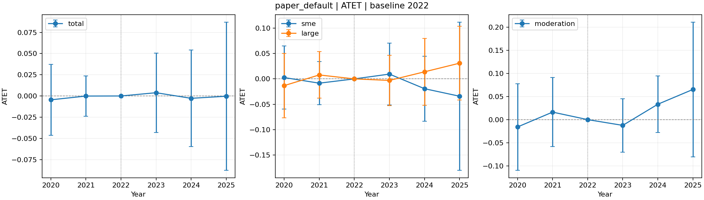

# 1. 완료한 작업

사용자와 설정을 정한 뒤 **기업별 생산성 결과를 유지하는 새 ATET·ACRT 실행기**를 구현했다.
기본은 GPS Spline·Mu XGBoost이며 두 모형 모두 여섯 종류의 학습기로 바꿀 수 있다.
산업별 결과 평균으로 집계하지 않았다. 새 GitHub 브랜치는 `feature/paper-aligned-did`이다.

기본 보간 설정과 내부 결측 구간 제외 설정을 각각 전체 5개 연도에서 실행했다.
각 실행은 ATET 20개, ACRT 주 결과·추가 비교 40개를 포함한 **60개 결과 모두 계산 완료**했다.
초기 전체 구간 시험에서 계산 불가였던 결과도 별도 보존했다. 효과 방향이나 유의성에 맞추는
설정 탐색은 수행하지 않았다.

| 사용자와 정한 항목 | 구현 |
|---|---|
| GPS | psmethod=1, 기본 Spline 평균 모형 + 조건부 정규밀도 |
| Mu | 기본 XGBoost, 기업별 생산성 차분을 학습 |
| 공변량 | GPS 산업 변수, Mu 산업·기업 변수; 기업 변수 제거 스위치 |
| 시점 | 산업·기업 통제변수를 2022년 값으로 고정 |
| 결측 | 학습 Fold 중앙값 + 결측 표시변수; 전체 표본 유지 |
| bandwidth | 산업 D의 표본 SD × 2.34 × n^(-1/4) × 0.7 |
| 지원 구간 | ESS 기준 없음; 트리밍 후 실제 계산 가능 여부만 확인 |
| ACRT 결측 구간 | 기본 보간, 옵션으로 해당 구간 기업 제외 |

자동 테스트 **29개**를 통과했다. 실제 자료의 nuisance를 고정한 6개 사례는 공식 R 점수
블록과 ATET·트리밍 수·iid 표준오차를 대조했고, 점추정 최대 차이는 약 **$1.01\times10^{-16}$**이었다.
이는 R의 전체 nuisance 학습·군집 모듈을 실행했다는 의미가 아니다.

# 2. 저자 구현에 맞춘 부분과 다른 부분

참고 논문은 Haddad et al. arXiv:2410.21105v2(2026-01-15), 패키지는
causalweight 1.1.6의 고정 커밋 `84b6412`이다.

**맞춘 부분:** 정규 GPS의 Fold별 공통 분산, np Epanechnikov 척도, SD 규칙과 0.7 배율,
두 팔 정규화, 양쪽 기업 가중치 트리밍 0.1, 저자의 centered ATET 점수이다.
분산은 저자 코드처럼 외부 검증 산업의 처치 잔차제곱 평균이다. 이는 검증 D를 사용한다는
특성이 있으며 학습 표본만으로 만든 이분산·smearing 방식과 구분했다.

밀도 하한을 넣지 않고 밀도비를 로그 공간에서 계산했다. 수학적으로 같은 비율을 안정적으로
계산하는 것이며 작은 밀도를 임의의 값으로 바꾸지 않는다. 최소 bandwidth 대체도 없다.

**사용자 자료에 맞춘 변경:** GPS는 산업당 한 행, Mu는 기업별 행, 외부·내부 Fold는 산업
단위, 표준오차도 산업 군집이다. R의 `cluster` 옵션만으로는 산업별 Fold가 생성되지 않는다.
R 함수에 기업 2,028행을 그대로 넣을 때의 n과 SD를 사용한 결과와는 다르다.

**사용자가 선택한 차이:** R 기본 Lasso 대신 GPS Spline·Mu XGBoost, 두 모형의 공변량 집합
차이, 기준연도 고정·결측 대체이다. Python Lasso 옵션도 glmnet과 같은 수치 엔진은 아니다.
GPS 평균 모형을 RF나 XGBoost로 바꿔도 psmethod=1의 조건부 정규분포 가정은 남는다.

**추가 단계:** ACRT의 유한차분·보간·기업 가중 평균과 그 집계 추론은 저자 패키지의 직접
ATET 출력 이후에 붙인 확장이다. 논문의 ATET 이론이 이 확장 전체를 자동 보장하지 않는다.

# 3. 실제 표본과 계산 설정

- 기업 2,028개, 산업 151개. SME 971개, Large 1,030개, 규모 미분류 27개.
- 미분류 기업은 전체 결과에는 포함하고 규모별 비교에서는 제외했다.
- 2022년 기업 통제변수 결측은 3개 기업의 3개 셀이며, Fold별 대체로 표본을 유지했다.
- GPS 입력은 산업 변수 12개와 산업 더미 20개. Mu는 산업 변수 13개, 기업 변수·규모 더미
  5개, 산업 더미 20개와 D를 포함해 원래 입력 39개이다. 결측 표시변수는 Fold별로 추가된다.
- 외부 산업 3-Fold, 내부 산업 10-Fold, seed 1, 반복 중앙값 없음.
- GPS는 5 knots·3차 Spline과 Ridge, 8개 alpha를 학습 Fold 내부 CV로 선택했다.
- Mu는 XGBoost 300 trees, depth 3, learning rate 0.03, subsample/colsample 0.8,
  min child weight 7이다. 과거 탐색의 연도별 최적값을 가져오지 않았다.
- 처치는 D=ln(office_ratio×100), 결과는 ln_firm_prod이다.
- 표본 SD는 약 0.8420313, **h=0.3934576**, 실제 커널 반폭은 **0.8797979**이다.
- 기본 ATET 비교점은 산업 D의 25분위 2.8107696 → 75분위 3.4686193이다.
- ACRT는 ATET(d,d−0.0005)/0.0005를 사용하고 실제 기업의 노출값에서 평균한다.
- 2020·2021은 기존 방식인 Y_2022−Y_과거, 이후는 Y_이후−Y_2022이다.

표준오차·정규근사 구간은 산업 군집 점수와 G/(G−1)을 반영한다. SME와 Large의 차이는
같은 산업의 점수 차이를 먼저 계산해 공분산을 유지한다. 공통 5,000회 산업 multiplier의
표준오차와 percentile 구간도 별도로 저장했다. 표의 p값은 보정 전 값이며 전체 주 결과의
실행 내 Holm 보정 값도 CSV에 있다.

# 4. 기본 시험 결과

## 두 처치값 사이의 ATET

각 셀은 **추정치 (p값)**이다. 이 표는 지정한 25분위→75분위의 비교이다.

| 연도 | 전체 | SME | Large | Large−SME |
|---:|---:|---:|---:|---:|
| 2020 | -0.0045 (0.831) | +0.0027 (0.933) | -0.0133 (0.683) | -0.0159 (0.739) |
| 2021 | -0.0001 (0.994) | -0.0084 (0.699) | +0.0078 (0.739) | +0.0162 (0.670) |
| 2023 | +0.0038 (0.872) | +0.0095 (0.760) | -0.0030 (0.907) | -0.0125 (0.673) |
| 2024 | -0.0028 (0.924) | -0.0193 (0.556) | +0.0140 (0.678) | +0.0333 (0.286) |
| 2025 | -0.0003 (0.995) | -0.0342 (0.647) | +0.0311 (0.403) | +0.0653 (0.380) |



## 기업별 노출분포에서 평균한 ACRT

각 집단의 기업 수 분포로 가중한 자체 평균을 사용했다. 조절효과는 Large 자체 평균에서
SME 자체 평균을 뺀 값이다. 같은 처치점에서만의 효과 차이와 완전히 같은 모수는 아니다.
공통 노출분포를 사용한 결과도 전체 CSV에 별도 포함했다.

| 연도 | 전체 | SME | Large | Large−SME |
|---:|---:|---:|---:|---:|
| 2020 | -0.0035 (0.875) | -0.0125 (0.745) | +0.0008 (0.974) | +0.0133 (0.777) |
| 2021 | -0.0262 (0.128) | -0.0477 (0.138) | -0.0099 (0.619) | +0.0378 (0.345) |
| 2023 | -0.0082 (0.715) | -0.0197 (0.494) | -0.0021 (0.953) | +0.0177 (0.692) |
| 2024 | +0.0007 (0.984) | -0.0304 (0.349) | +0.0286 (0.596) | +0.0590 (0.259) |
| 2025 | +0.0254 (0.600) | +0.0140 (0.839) | +0.0311 (0.520) | +0.0170 (0.799) |


이 기본값에서 2020·2021의 주 결과는 유의하지 않았다. 2023년 전체 ACRT는 음수지만
유의하지 않았고, 2025년 SME ACRT는 +0.0140이나 p=0.839로 유의하지 않았다.
따라서 이전에 원했던 유의한 효과 패턴이 이 설정에서 확인되었다고 해석할 수 없다.
특정 두 처치값의 ATET와 자체 노출분포에서 평균한 ACRT는 서로 다른 모수이다.

# 5. 계산 불가 구간과 보간·제외

첫 시험에서는 원래 전체 격자를 유지했다. 낮은 D에서 양쪽 트리밍 후 팔이 비어 필요한
끝점이 계산되지 않아 ACRT 합산이 미정의였다. 이는 ESS 임계값 때문에 제외된 것이 아니다.
이 초기 결과와 실패 끝점 45건(5연도×3집단×3끝점)을 별도 저장했다.

사용자 선택에 따라 기본을 계산 가능한 구간의 보간으로 바꾸고, 제외 옵션도 구현했다.
전체 D 격자는 13,465개이며 계산 가능 여부는 결과변수 Y를 사용하지 않고 가중치로만 판단한다.
전체 곡선은 D≤약 0.21399에서 계산 불가였고, 규모별 곡선에는 일부 내부 결측 구간도 있었다.

| 집단 | 평균 대상 기업 | 최종 포함 | 포함률 |
|---|---:|---:|---:|
| 전체 | 2,028 | 2,024 | 99.803% |
| SME | 971 | 969 | 99.794% |
| Large | 1,030 | 1,028 | 99.806% |
| 공통 노출 평균의 대상 | 2,001 | 1,997 | 99.800% |

이번 표본에는 내부 결측 구간을 가로질러 보간해야 하는 실제 기업이 없었다.
따라서 **보간·제외의 60개 추정값 차이는 모두 0**이었다. 두 옵션이 같은 기능인 것은
아니며, 내부 구간에 기업이 있는 합성 자료 테스트에서는 포함 기업 수가 달라지는 것을
확인했다. 최외곽의 기업 4개는 양쪽 보간점이 없어 두 방식 모두 ACRT 평균에서 제외했다.
외삽하지 않았다. 이 기업들은 GPS·Mu 학습 표본에서는 유지했다.

# 6. R 대조와 재현 파일

R 4.5에서 공식 didcontDMLpanel 함수의 점수 블록을 실행했다. 실제 2023년 nuisance를
고정하고 중앙 ATET·국소 ATET의 전체/SME/Large 6개 사례를 비교했다.
트리밍 수가 모두 일치했고 ATET 최대 차이는 $1.01\times10^{-16}$, iid SE 차이는 $3.70\times10^{-18}$ 이하였다.
실제 분석은 군집 SE를 사용한다. R 대조의 iid SE를 실제 분석의 SE로 사용하지 않았다.

합성 자료의 공식 R 고정 점수 4개 사례에서는 트리밍이 발생하는 경우까지 테스트한다.
모형 6종, 외부 검증 Y의 학습 누출 방지, 산업 분할과 Mu/GPS Fold 일치, 산업 압축 계산,
보간/제외·외삽 금지, 공분산, 체크포인트를 포함한 전체 자동 테스트 29개가 통과했다.

```bash
python run_paper.py --out results/my_trial
python run_paper.py --set 'gap_policy="exclude"' --out results/my_exclude
python run_paper.py --set 'acrt_support="strict"' --out results/my_strict
python -m unittest discover -s tests -v
```

주요 설정과 단계별 함수 설명은 `paper_did/README.ko.md`에 있다. 실제 실행의 모든 설정,
모형 진단·표본 해시·버전은 결과 폴더에 저장했다. 학습기 변경이나 기업 변수 제외는
paper_settings.json 또는 --set으로 지정할 수 있으며 과거 코드를 바꾸지 않는다.

- `audit/results/paper_aligned/interpolate_*`: 기본 결과·설정·진단.
- `exclude_*`: 제외 설정의 결과·설정·진단.
- `initial_strict_*`: 최초 미정의 결과와 실패 기록.
- `r_score_comparison.csv`: 실제 고정 nuisance의 R 대조 집계.
- `validation/check_paper_score.py`: 대조용 입력 생성·비교. 기업 수준 중간 입력은
  ignored results에만 생성하며 저장소에는 대조 집계만 포함했다.

이번 작업은 구현과 정해진 기본값의 시험이다. 조건부 평행추세, 처치 이후 통제 여부,
산업 배정 GPS와 기업 가중 목표의 연결, 작은 산업 표본에서의 nuisance 수렴률을 증명한
것은 아니다. 산업·기업 공변량의 차이와 ACRT 확장을 논문 그대로의 보장으로 설명하지 않는다.

# 7. 원문과 코드

1. [Haddad et al., arXiv:2410.21105v2](https://arxiv.org/abs/2410.21105v2), 패널 ATET 및 6절 이론.
2. [causalweight 고정 함수 소스](https://github.com/cran/causalweight/blob/84b6412a13a2b7953e73ae2cacc8b696f7a6a18a/R/didcontDMLpanel.R).
3. [새 GitHub 브랜치](https://github.com/wnghks3758-star/AI_diffusion_to_Labor_Productivity/tree/feature/paper-aligned-did).
