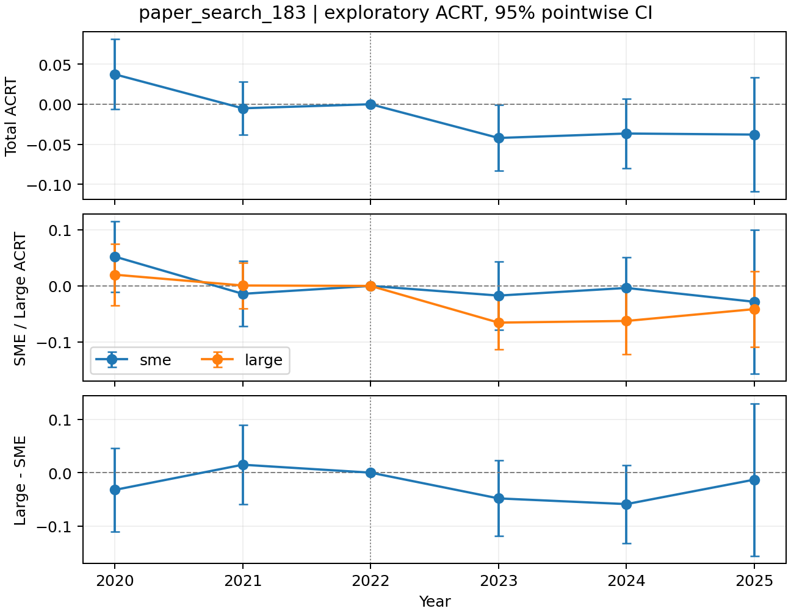
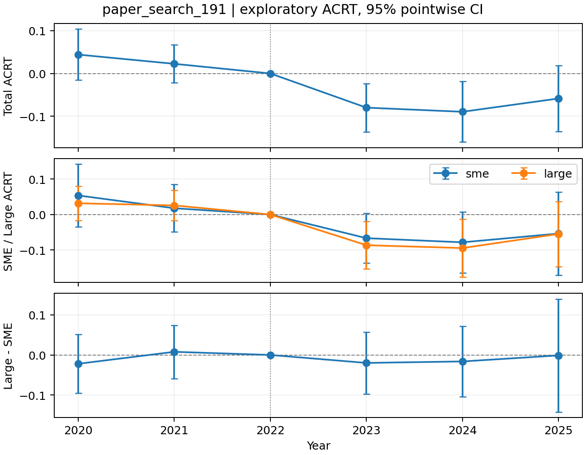
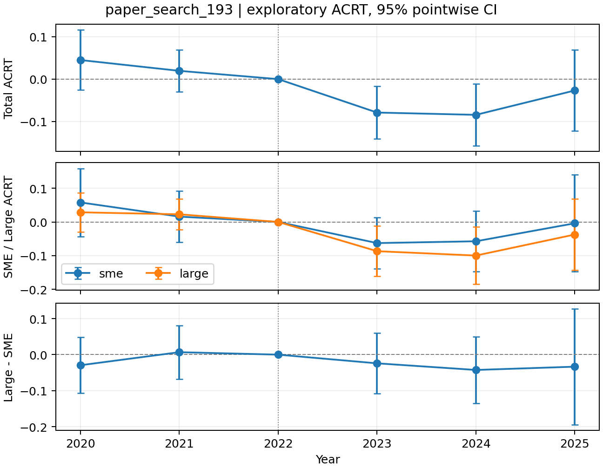
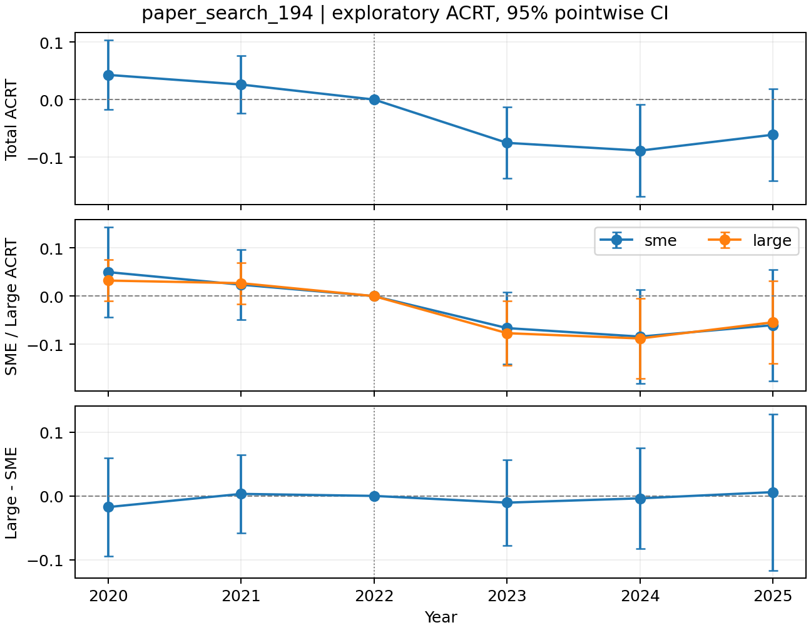
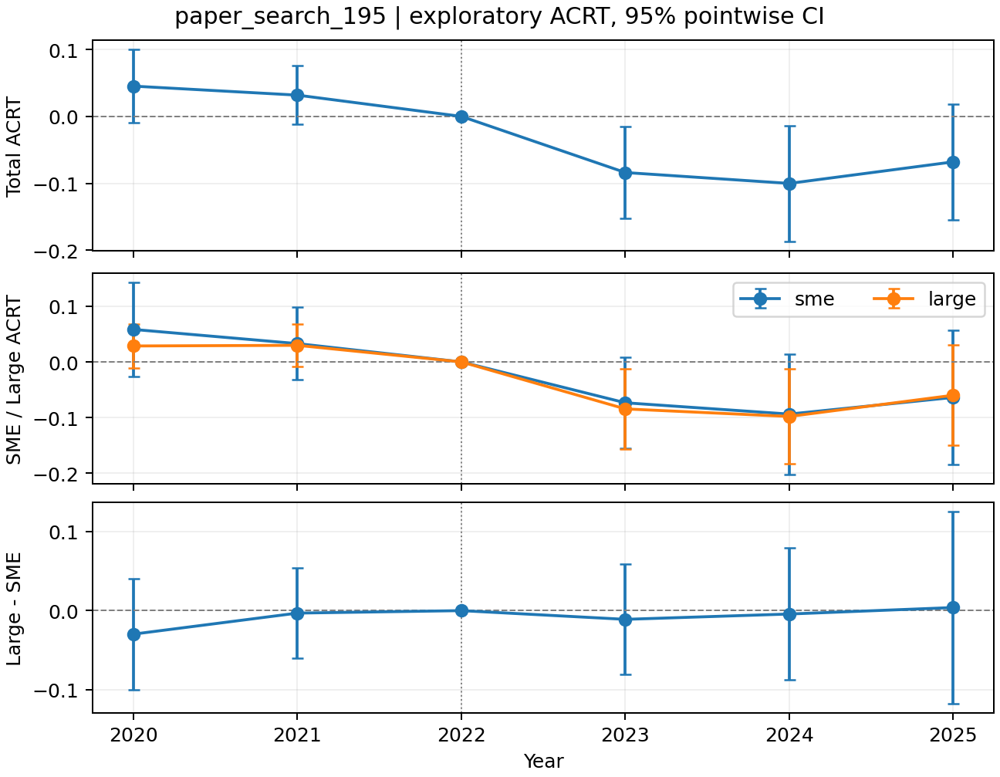

# 논문 방식 기반 200개 설정 탐색

200개 설정 중 사전 기준과 초기 하락 기준을 모두 통과한 설정은 5개입니다. 전체 가설 충족은 0개, 2025년 SME 유의한 양수까지 충족한 설정은 0개입니다.

## 탐색과 중단 기준

가설 판정 대상은 기존 방식으로 연결한 finite-difference ACRT입니다. 고정 두 처치점의 ATET는 별도 결과로 보존하며 두 추정 대상을 혼용하지 않았습니다. 200개 설정은 실행 전에 확정했습니다. 기본 설정을 제외한 199개는 비교 설정입니다. 40개 변수·학습기 조합에 각각 5개 bandwidth·트리밍 조합을 적용했습니다.

2020년과 2021년의 전체·SME·Large·Large−SME가 모두 p≥0.05여야 하며, 2023년 전체 효과가 음수이고 p<0.05여야 합니다. 한 조건이라도 실패하면 즉시 중단하고 그 설정의 추정치·로그·학습 캐시는 삭제했습니다. 아래에는 통과한 설정만 기술하며, 탈락 설정별 결과는 남기지 않았습니다. 실행 전에 정한 설정 목록과 중단 유형별 건수는 재현성과 탐색 규모 확인을 위해 보존했습니다.

첫 70개는 2020→2021→2023 순서로 검사했습니다. 초기 하락 기준에서 중단되는 경우가 대부분이어서 남은 130개는 2023→2020→2021 순서로 검사해 계산을 줄였습니다. 변수·모형·수치 설정 200개와 판정 기준은 바꾸지 않았으며, plan.original.json과 plan.json의 entries는 완전히 같습니다. 진행 중이던 미완료 묶음은 같은 설정으로 다시 계산했습니다. 검사를 먼저 통과하지 못하면 이후 조건은 계산하지 않으므로 중단 유형별 건수는 그 순서에 의존합니다.

| 구분 | 건수 |
| --- | --- |
| 총 시도 | 200 |
| 2020년 사전 기준 중단 | 0 |
| 2021년 사전 기준 중단 | 1 |
| 2023년 전체 유의한 하락 미충족 | 194 |
| 수치 계산 실패 | 0 |
| 실행 오류 | 0 |
| 기준 통과·결과 저장 | 5 |

## 변경한 변수와 설정

GPS 산업 변수 12개, Mu 산업 변수 13개, Mu 기업 변수 5개를 각각 하나씩 제외하는 30개 조합을 기본 조합과 비교했습니다. 추가 9개 조합에서는 산업·기업 변수를 개별 확률 추출(seed 2026102303)로 포함하거나 제외했습니다. GPS의 근로시간 변수는 추가 조합에서 포함될 수도 있습니다. Mu 기업 변수는 large_dummy, small_dummy, firm_rnd_ratio, ln_firm_avg_pay, ln_firm_ast입니다. 처치 D는 Mu에 별도로 유지했습니다.

기본 GPS Spline·Mu XGBoost 외에 GPS Random Forest·Lasso·Ridge·선형·XGBoost와 Mu Random Forest·Lasso·Ridge·Spline을 포함했습니다. 추가 조합에서는 산업 Fold 수 3/4/5, seed 1/42/2026, spline knot 3/4/5·차수 2/3, 산업 분류의 최소 관측수 2/4/8·최소 산업수 2/4/6, 대분류 및 산업 더미 제외, 기업 변수 전체 제외도 비교했습니다. 개별 설정의 정확한 값과 변수 목록은 planned_settings.csv와 plan.json에 있습니다.

모든 변수·학습기 조합에 적용한 (bandwidth 배율, 트리밍)은 (0.70, 0.10), (0.45, 0.10), (0.55, 0.05), (0.85, 0.10), (1.00, 0.15)입니다. Bandwidth는 산업 수와 산업 처치값의 표본 표준편차로 저자 방식의 공식을 계산한 뒤 해당 배율을 곱했습니다. 배율 0.70이 저자 패키지 기준입니다.

## 유지한 추정 원칙과 전체 가설

2022년 기준 통제변수, 산업별 GPS·산업 Fold·산업 군집 추론, psmethod=1 정규밀도와 검증 Fold 산업 잔차의 공통 분산, 훈련 Fold 중앙값 대체·결측 표시변수, ESS 제외 기준 없음, 밀도 하한 없음, 내부 누락 구간 보간을 유지했습니다. 표본은 기존 균형 패널이며 결과의 실제 ACRT 평균 대상 비율은 각 저장 설정의 coverage에 기록합니다. 유한차분 간격 0.0005, 보조 군집 bootstrap 5,000회, Large−SME는 각 규모의 자체 기업 평균 차이입니다.

전체 가설은 위 두 저장 기준에 더해 전체·SME·Large의 2023≤2024≤2025 회복(2025>2023), SME의 더 이른 양수 전환, 사후 모든 연도의 Large−SME 음수와 지속적 유의 또는 2025년 유의·2023년 대비 p값 감소를 요구합니다. 여기에 SME 2025년 유의한 양수를 추가하면 선호 조건 충족입니다. 사전 비유의는 평행추세가 성립한다는 증명이 아닙니다.

## 기준을 통과한 설정


```{=latex}
\clearpage
```

```{=openxml}
<w:p><w:r><w:br w:type="page"/></w:r></w:p>
```

### paper_search_183

전체 가설: False, 선호 조건: False, 조건 충족 수: 2/6, 최소 평균 대상 비율: 99.79%.

GPS spline / Mu random_forest; bandwidth 배율 0.55; trim 0.05; Fold 5; seed 2026.

Spline knot 5·차수 2; 산업 분류 refined·최소 산업수 6·최소 관측수 8; 산업 더미 True; GPS 파라미터 {}; Mu 파라미터 {"n_estimators": 150, "max_depth": 3, "min_samples_leaf": 8}.

GPS 변수: ln_ind_avg_pay, ln_ind_ast, ind_rnd_ratio, ln_cum_patent, ind_college_share_pre, ind_large_est_share_pre, ind_age50_share_pre, ind_avg_tenure_pre, ind_avg_hours_pre, ind_ln_avg_pay_pre.

Mu 산업 변수: ln_ind_avg_pay, ln_ind_ast, ind_rnd_ratio, ln_cum_patent, ind_college_share_pre, ind_avg_age_pre, ind_female_share_pre, ind_ln_avg_pay_pre.

Mu 기업 변수: large_dummy, small_dummy, firm_rnd_ratio.

| 연도 | 전체 (p) | SME (p) | Large (p) | Large−SME (p) |
| --- | --- | --- | --- | --- |
| 2020 | 0.0374 (0.0934) | 0.0523 (0.1022) | 0.0200 (0.4777) | -0.0323 (0.4162) |
| 2021 | -0.0051 (0.7626) | -0.0141 (0.6342) | 0.0007 (0.9714) | 0.0148 (0.6944) |
| 2023 | -0.0421 (0.0451) | -0.0172 (0.5807) | -0.0655 (0.0071) | -0.0482 (0.1812) |
| 2024 | -0.0366 (0.0996) | -0.0036 (0.8980) | -0.0625 (0.0399) | -0.0589 (0.1129) |
| 2025 | -0.0379 (0.2975) | -0.0284 (0.6649) | -0.0414 (0.2305) | -0.0130 (0.8579) |




```{=latex}
\clearpage
```

```{=openxml}
<w:p><w:r><w:br w:type="page"/></w:r></w:p>
```

### paper_search_191

전체 가설: False, 선호 조건: False, 조건 충족 수: 2/6, 최소 평균 대상 비율: 99.79%.

GPS spline / Mu ridge; bandwidth 배율 0.7; trim 0.1; Fold 4; seed 42.

Spline knot 4·차수 2; 산업 분류 refined·최소 산업수 4·최소 관측수 4; 산업 더미 True; GPS 파라미터 {}; Mu 파라미터 {"alpha": 1.0}.

GPS 변수: ind_rnd_ratio, ln_cum_patent, ind_college_share_pre, ind_avg_age_pre, ind_permanent_share_pre, ind_avg_tenure_pre, ind_avg_hours_pre, ind_ln_avg_pay_pre.

Mu 산업 변수: ln_ind_avg_pay, ln_ind_ast, ind_rnd_ratio, ln_cum_patent, ind_college_share_pre, ind_large_est_share_pre, ind_age50_share_pre, ind_female_share_pre, ind_permanent_share_pre, ind_avg_tenure_pre, ind_avg_hours_pre, ind_ln_avg_pay_pre.

Mu 기업 변수: 제외.

| 연도 | 전체 (p) | SME (p) | Large (p) | Large−SME (p) |
| --- | --- | --- | --- | --- |
| 2020 | 0.0440 (0.1461) | 0.0537 (0.2340) | 0.0317 (0.1947) | -0.0220 (0.5558) |
| 2021 | 0.0225 (0.3192) | 0.0177 (0.6029) | 0.0256 (0.2370) | 0.0078 (0.8170) |
| 2023 | -0.0797 (0.0057) | -0.0665 (0.0630) | -0.0863 (0.0114) | -0.0198 (0.6142) |
| 2024 | -0.0894 (0.0130) | -0.0782 (0.0739) | -0.0944 (0.0229) | -0.0161 (0.7191) |
| 2025 | -0.0584 (0.1382) | -0.0535 (0.3694) | -0.0546 (0.2436) | -0.0011 (0.9878) |




```{=latex}
\clearpage
```

```{=openxml}
<w:p><w:r><w:br w:type="page"/></w:r></w:p>
```

### paper_search_193

전체 가설: False, 선호 조건: False, 조건 충족 수: 2/6, 최소 평균 대상 비율: 99.79%.

GPS spline / Mu ridge; bandwidth 배율 0.55; trim 0.05; Fold 4; seed 42.

Spline knot 4·차수 2; 산업 분류 refined·최소 산업수 4·최소 관측수 4; 산업 더미 True; GPS 파라미터 {}; Mu 파라미터 {"alpha": 1.0}.

GPS 변수: ind_rnd_ratio, ln_cum_patent, ind_college_share_pre, ind_avg_age_pre, ind_permanent_share_pre, ind_avg_tenure_pre, ind_avg_hours_pre, ind_ln_avg_pay_pre.

Mu 산업 변수: ln_ind_avg_pay, ln_ind_ast, ind_rnd_ratio, ln_cum_patent, ind_college_share_pre, ind_large_est_share_pre, ind_age50_share_pre, ind_female_share_pre, ind_permanent_share_pre, ind_avg_tenure_pre, ind_avg_hours_pre, ind_ln_avg_pay_pre.

Mu 기업 변수: 제외.

| 연도 | 전체 (p) | SME (p) | Large (p) | Large−SME (p) |
| --- | --- | --- | --- | --- |
| 2020 | 0.0450 (0.2134) | 0.0579 (0.2617) | 0.0286 (0.3377) | -0.0293 (0.4579) |
| 2021 | 0.0195 (0.4379) | 0.0158 (0.6835) | 0.0226 (0.3339) | 0.0068 (0.8565) |
| 2023 | -0.0789 (0.0129) | -0.0628 (0.1054) | -0.0869 (0.0228) | -0.0241 (0.5730) |
| 2024 | -0.0843 (0.0235) | -0.0574 (0.2079) | -0.0999 (0.0211) | -0.0424 (0.3679) |
| 2025 | -0.0268 (0.5831) | -0.0040 (0.9561) | -0.0374 (0.4891) | -0.0334 (0.6838) |




```{=latex}
\clearpage
```

```{=openxml}
<w:p><w:r><w:br w:type="page"/></w:r></w:p>
```

### paper_search_194

전체 가설: False, 선호 조건: False, 조건 충족 수: 2/6, 최소 평균 대상 비율: 99.90%.

GPS spline / Mu ridge; bandwidth 배율 0.85; trim 0.1; Fold 4; seed 42.

Spline knot 4·차수 2; 산업 분류 refined·최소 산업수 4·최소 관측수 4; 산업 더미 True; GPS 파라미터 {}; Mu 파라미터 {"alpha": 1.0}.

GPS 변수: ind_rnd_ratio, ln_cum_patent, ind_college_share_pre, ind_avg_age_pre, ind_permanent_share_pre, ind_avg_tenure_pre, ind_avg_hours_pre, ind_ln_avg_pay_pre.

Mu 산업 변수: ln_ind_avg_pay, ln_ind_ast, ind_rnd_ratio, ln_cum_patent, ind_college_share_pre, ind_large_est_share_pre, ind_age50_share_pre, ind_female_share_pre, ind_permanent_share_pre, ind_avg_tenure_pre, ind_avg_hours_pre, ind_ln_avg_pay_pre.

Mu 기업 변수: 제외.

| 연도 | 전체 (p) | SME (p) | Large (p) | Large−SME (p) |
| --- | --- | --- | --- | --- |
| 2020 | 0.0429 (0.1617) | 0.0498 (0.2952) | 0.0323 (0.1397) | -0.0175 (0.6546) |
| 2021 | 0.0261 (0.3079) | 0.0237 (0.5241) | 0.0268 (0.2186) | 0.0031 (0.9207) |
| 2023 | -0.0753 (0.0172) | -0.0662 (0.0832) | -0.0768 (0.0239) | -0.0106 (0.7580) |
| 2024 | -0.0887 (0.0298) | -0.0839 (0.0902) | -0.0877 (0.0372) | -0.0038 (0.9243) |
| 2025 | -0.0611 (0.1332) | -0.0601 (0.3072) | -0.0542 (0.2146) | 0.0060 (0.9241) |




```{=latex}
\clearpage
```

```{=openxml}
<w:p><w:r><w:br w:type="page"/></w:r></w:p>
```

### paper_search_195

전체 가설: False, 선호 조건: False, 조건 충족 수: 2/6, 최소 평균 대상 비율: 99.90%.

GPS spline / Mu ridge; bandwidth 배율 1.0; trim 0.15; Fold 4; seed 42.

Spline knot 4·차수 2; 산업 분류 refined·최소 산업수 4·최소 관측수 4; 산업 더미 True; GPS 파라미터 {}; Mu 파라미터 {"alpha": 1.0}.

GPS 변수: ind_rnd_ratio, ln_cum_patent, ind_college_share_pre, ind_avg_age_pre, ind_permanent_share_pre, ind_avg_tenure_pre, ind_avg_hours_pre, ind_ln_avg_pay_pre.

Mu 산업 변수: ln_ind_avg_pay, ln_ind_ast, ind_rnd_ratio, ln_cum_patent, ind_college_share_pre, ind_large_est_share_pre, ind_age50_share_pre, ind_female_share_pre, ind_permanent_share_pre, ind_avg_tenure_pre, ind_avg_hours_pre, ind_ln_avg_pay_pre.

Mu 기업 변수: 제외.

| 연도 | 전체 (p) | SME (p) | Large (p) | Large−SME (p) |
| --- | --- | --- | --- | --- |
| 2020 | 0.0453 (0.1032) | 0.0584 (0.1748) | 0.0286 (0.1556) | -0.0297 (0.4094) |
| 2021 | 0.0318 (0.1568) | 0.0329 (0.3215) | 0.0298 (0.1243) | -0.0031 (0.9153) |
| 2023 | -0.0839 (0.0159) | -0.0735 (0.0791) | -0.0845 (0.0214) | -0.0110 (0.7570) |
| 2024 | -0.1002 (0.0234) | -0.0938 (0.0890) | -0.0981 (0.0239) | -0.0043 (0.9200) |
| 2025 | -0.0680 (0.1240) | -0.0639 (0.3021) | -0.0600 (0.1915) | 0.0039 (0.9496) |




```{=latex}
\clearpage
```

```{=openxml}
<w:p><w:r><w:br w:type="page"/></w:r></w:p>
```

## 탐색적 해석과 파일

변수와 설정을 결과 기준으로 선택한 탐색이므로 선택된 원래 p값을 확증적 검정으로 해석할 수 없습니다. 저장 기준 자체도 결과를 선택합니다. 이번 200개×20개 ACRT 검정을 계획된 4,000개 검정으로 잡은 Bonferroni 보정값(p_bonferroni_search)을 별도로 제공합니다. 중단·삭제된 검정도 계획된 검정 수에서 제외하지 않았습니다. 이는 이번 배치에 대한 보정이며 이전의 여러 탐색까지 포함하지 않습니다. 원래 점별 추론의 정규성·식별 가정과 ACRT 변환·산업 군집 확장에 관한 한계도 남습니다.

plan.json / planned_settings.csv: 실행 전 확정한 전체 설정. progress.json / summary.json: 실행·중단 건수. retained_flags.csv / retained_estimates.csv: 저장 기준을 통과한 설정만의 판정과 결과. retained/ 아래에는 해당 설정값, 연도별 계산 진단, ATET·ACRT 결과와 그래프가 있습니다. 학습 모델·원자료는 보고서 업로드에 포함하지 않습니다.

계획 SHA256: `56bced8435f81358caa6b2e62e38860c7da14804d0c79e0ad566123a54206eed`

추정 소스 SHA256: `13c940c2403a681cfddefddb0d8f58498769805c8a315e871aeffb0d28ae8fdc`
